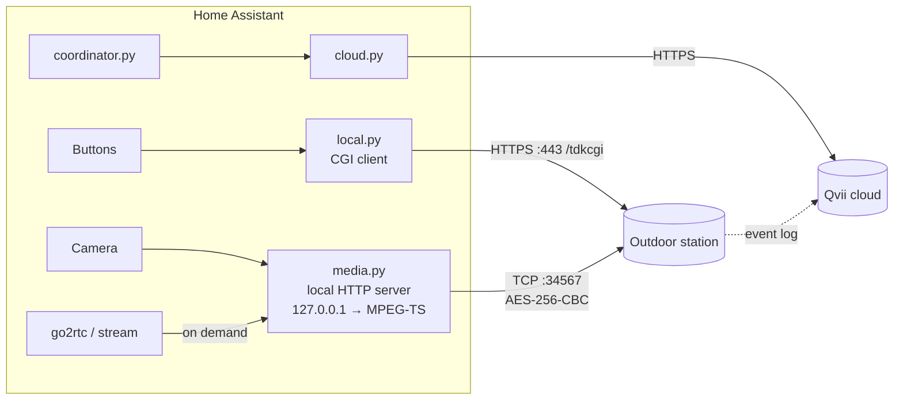

# DoorConnect v3 for Home Assistant

[](https://github.com/Neurones67/doorconnect-v3-homeassistant/actions/workflows/validate.yml)
[](https://github.com/Neurones67/doorconnect-v3-homeassistant/actions/workflows/tests.yml)
[](https://hacs.xyz/docs/faq/custom_repositories/)

Unofficial Home Assistant integration for the **Philips WelcomeEye Connect 3** video door
station, the device paired with the **Philips Door Connect** Android app
(`com.extel.philipsdoorconnect`).

> **Which integration do I need?** Older models (WelcomeEye **Connect 2** and earlier) are
> covered by the existing community integration
> [Mins95/WelcomeEye](https://github.com/Mins95/WelcomeEye). The **Connect 3** uses different
> protocols: LAN discovery, framing and encryption all differ. That is why this integration is a
> separate project with its own domain, `doorconnect_v3`. Both can be installed side by side.

| Feature | How | Needs Internet? |
|---|---|---|
| Open the door strike / gate | `Open door strike` and `Open gate` buttons | no (fully local) |
| Show the camera on demand | `camera` entity (WebRTC via go2rtc, or HLS) + `Refresh image` button | no (fully local) |
| Browse the history (unlocks with their method, calls) | sensors + `doorconnect_v3_event` events + Logbook entries | **yes** (the app's cloud, account required) |

> ⚠️ This project comes from reverse engineering and is not affiliated with Philips, Extel or
> Qualvision. It has been tested on **a single device**: outdoor station **IDS94E6W**, firmware
> `V401.R001.A331.00.G0123.B018`. Other models or firmware versions may behave differently.

---

## Installation

1. Install the integration, either:
   - **with HACS** (recommended):
     [](https://my.home-assistant.io/redirect/hacs_repository/?owner=Neurones67&repository=doorconnect-v3-homeassistant&category=integration)
     or, by hand: *HACS → ⋮ → Custom repositories*, add
     `https://github.com/Neurones67/doorconnect-v3-homeassistant` with type *Integration*, then
     download *DoorConnect v3*;
   - **manually**: copy `custom_components/doorconnect_v3/` into the `config/custom_components/`
     folder of Home Assistant.
2. Restart Home Assistant.
3. Go to *Settings → Devices & services → Add integration → DoorConnect v3*.
4. Enter:
   - **the IP address of the outdoor station**. A fixed IP (DHCP reservation) is recommended.
   - **the device code**: the 6-digit code the DoorConnect app asks for this door station.
   - *(optional)* **the email and password of the DoorConnect account** that owns the device. This
     is only used for the history; leave it empty to stay fully local.

Minimum version: Home Assistant 2026.9. There are no Python requirements: the integration uses
`aiohttp`, `cryptography` and `av` (PyAV), which ship with Home Assistant.

### Options

| Option | Default | Purpose |
|---|---|---|
| History polling interval | 5 min | how often the cloud is polled |
| Local video server bind address | `127.0.0.1` | change only if go2rtc runs on another host |
| Local video server port | `0` (auto) | set a fixed port if an external go2rtc must connect to it |

---

## Entities

Entity IDs below assume an English Home Assistant instance. A French translation is included.

| Entity | Description |
|---|---|
| `button.door_station_open_door_strike` | opens output 1 (door strike) |
| `button.door_station_open_gate` | opens output 2 (gate); disable it if no gate is wired |
| `camera.door_station_camera` | 2048×1152 live stream (~15 fps), only open while someone is watching |
| `button.door_station_refresh_image` | grabs a new still image for the camera |
| `sensor.door_station_last_event` | label of the latest event; the `history` attribute holds the last 25 |
| `sensor.door_station_last_unlock` | timestamp of the last unlock; attributes `output` (`strike`/`gate`), `method` |
| `sensor.door_station_last_call` | timestamp of the last call from the outdoor station; attribute `snapshot_url` |

The sensors only exist when a cloud account has been configured.

Unlock methods (`method`): `rf_badge`, `app`, `indoor_monitor`, `password`, `qrcode`,
`exit_button`, `dtmf`, `face`, `google`, `alexa`, `default`.

### The `doorconnect_v3_event` event

This event is fired for every **new** history entry. It also shows up in the Logbook, for example
"Door station: Door strike opened (RFID badge) (at 12:00)". Event data: `type` (`unlock`, `ring`,
`motion`, `other`), `output`, `method`, `badge`, `source`, `time`, `description`, `snapshot_url`,
`raw_*`.

```yaml
automation:
  - alias: "Notify badge unlocks"
    trigger:
      - platform: event
        event_type: doorconnect_v3_event
        event_data: { type: unlock }
    action:
      - service: notify.mobile_app_my_phone
        data:
          message: "{{ trigger.event.data.description }} at {{ trigger.event.data.time }}"
```

> The history is **polled**, so an event reaches HA up to one polling interval late. It is not a
> real-time doorbell trigger.

### Dashboard example

```yaml
type: vertical-stack
cards:
  - type: picture-entity
    entity: camera.door_station_camera
    camera_view: auto          # still image; tap to open the live view
  - type: horizontal-stack
    cards:
      - type: button
        entity: button.door_station_open_door_strike
        tap_action: { action: toggle, confirmation: { text: "Open the door?" } }
      - type: button
        entity: button.door_station_open_gate
        tap_action: { action: toggle, confirmation: { text: "Open the gate?" } }
  - type: markdown
    content: >
      
      - {{ e.time[:16] | replace('T', ' ') }} — {{ e.description }}
      
```

---

## How it works



### 1. Local control: HTTPS CGI `/tdkcgi` (port 443) — `local.py`

The outdoor station runs a GoAhead web server that accepts XML commands:

```xml
POST https://<ip>/tdkcgi        Cookie: _goaheadwebSessionId=<any value>
<envelope>
  <header><security>username</security><username>adminapp2</username>
          <password>SHA256_HEX(device code)</password></header>
  <body><command>set.device.opendoor</command>
        <content><door>1</door><locknumber>1</locknumber>
                 <password>SHA256_HEX(device code)</password></content></body>
</envelope>
```

- `adminapp2` is the fixed user the app uses in LAN mode. The password is the lowercase hex
  SHA-256 of the 6-digit code.
- `locknumber` 1 = door strike, 2 = gate. `<error>0</error>` means success.
- The server certificate is self-signed and is not verified. A QUALVISION client certificate is
  bundled in the APK, but **the device does not require it**: no certificate is used or
  distributed here.
- Commands used: `get.product.info` (model, firmware, MAC), `get.device.streamkey` (video stream
  key), `set.device.opendoor`.
- With a wrong code the device **deliberately stalls its answer** (anti brute-force), so that
  error shows up as a timeout.

### 2. Local video: proprietary protocol on TCP 34567 — `media.py`

No RTSP or ONVIF server runs on the device: only ports 443 and 34567 are open. Video uses the
protocol of the app's native library (`liblive_player.so`):

1. **Negotiation**: 32 bytes in clear, `[0]=0xA9`. The device answers 32 bytes.
2. **Encryption**: every later message is encrypted with AES-256-CBC. The key is the
   **stream key** (32 characters, read via the CGI) and the IV is `"0"×16`. The 32-byte header and
   the body are encrypted separately, and the body is followed by SHA-256(header ‖ body).
   Header layout: `[0]` type, `[1:9]` Unix timestamp, `[9]` ext, `[11:13]` body length.
3. **Login** (type `0x01`): `adminapp2&&<sha256(code)>\0G0123A0058G0058\0clientid=<16 hex>\0`.
4. **Stream start**: three `0xFE` messages with sub-types `05`, `06`, `02`, exactly as the app
   sends them.
5. **Keepalive**: message `0x00` every 2 s.
6. **Frames** `0xA0–0xA3`: only the **first 32 bytes** of each frame are encrypted. A frame holds:
   - a 16-byte descriptor: `00 00 01 E1` keyframe, `E0` P-frame, `E3` audio; `[8:12]` Unix
     seconds, `[12:14]` milliseconds;
   - a 4-byte marker;
   - **H.264 Annex-B** in clear (SPS/PPS/IDR on keyframes).

On the Home Assistant side:

- The device **accepts only one video session at a time**. The integration opens the 34567
  connection **only when a player asks for it**, shares it between all viewers, and closes it 5 s
  after the last one leaves.
- A small HTTP server serves the stream as **MPEG-TS** with timestamps taken from the device
  clock. It listens on `127.0.0.1` by default and is protected by a random token. This is the
  camera's `stream_source`, read by go2rtc (WebRTC) or by HA's `stream` component (HLS). Raw H.264
  has no timestamps, and HA's stream worker rejects packets without DTS: this is why MPEG-TS is
  used. A `/<token>/live.h264` endpoint (raw H.264) also exists for debugging.
- New viewers start immediately thanks to the buffered current GOP.
- The **still image** is the last decoded keyframe (PyAV → JPEG). It is updated during live viewing
  and by the "Refresh image" button. It is **never** refreshed in the background: otherwise a
  dashboard card would open a session every 10 s and lock the app out.
- Only the message types listed above are ever sent. Others (`0x0B/0x0C/0x0D` "talk", `0x0E`)
  triggered the **emergency mode** of the indoor monitor during testing: do not add them without
  care.

### 3. History: Qvii cloud — `cloud.py`, `coordinator.py`

The door station keeps no readable local log: the app reads its history from the OEM's cloud
(Qualvision/Qvii). The integration replays the app's calls:

0. **Server lookup**: the app only knows one bootstrap server, `sh2.qvcloud.net`. Its native P2P
   library sends it `GET /mst/query` with an XML `query-hlrv2` command listing the wanted services
   (`userapp`, `alarmapp`, `oauth2`, each with a `sec-` variant), and gets back the URL of each
   service for the caller's region. The integration sends the same request; it needs no
   credentials and no client certificate. Example answer for a European connection: OAuth on
   `oauth2shi.qvcloud.net`, login on `shi-18-sec.qvcloud.net`, history on
   `shi-25-sec.qvcloud.net:4443`. If the lookup fails, the integration falls back to known servers.
1. **OAuth**: `GET <oauth2>/qvoauthv2/token` with `grant_type=password` and
   `pwd = sha256_hex(password)`. It returns a JWT whose `qv-uid` claim is the account ID.
2. **User login** on the `sec-userapp` server, through a long-polling "duplex" channel:
   `GET /auth/user;jus_duplex=down` (session cookie), then `POST /auth/user;jus_duplex=up` (XML
   `login` command). The answer, which holds the `SESSION_ID`, comes back on a new
   `GET …;jus_duplex=down`.
3. **Alarm server login**: `POST <sec-alarmapp>/UserAlarm` with the `client-login` command. The app sends
   `Content-Type: application/xml` **without** a charset, plus a separate `charset: utf-8` header.
   Without that detail the server answers `1009`.
4. **Reading**: `client-query-recordlist` with an empty filter, `maxid` 0 then the returned value,
   `pageno` **starting at 0**, 15 rows per page. The integration reads 2 pages, i.e. the last 30
   events.

Observed mapping:
- `event 63` = unlock. `alarminfo` gives the output (1 = strike, 2 = gate) and `alarmstate` the
  method (4 = app, 5 = badge, 3 = indoor monitor, …).
- `event 19` = call from the outdoor station.

Behaviour:
- The session is reopened automatically when it expires (`1009`/`1012`).
- If the cloud rejects the password, the integration **stops and asks for re-authentication**
  instead of retrying, because the account gets **locked** after a few failures.
- The servers are looked up again at every login, so a server move on the vendor side (which
  shows up as HTTP 404 on `/UserAlarm`) is followed automatically.
- The region is the one the bootstrap server derives from the caller's IP address, like the app
  does before login. This has only been tested from Europe.
- Cloud timestamps are local time; they are interpreted in HA's time zone.

---

## Known limitations

- **One video session at a time**: while HA shows the live view, the DoorConnect app cannot open
  the video, and vice versa.
- **No audio**: `E3` frames (probably G.711) are not decoded. No intercom.
- **No real-time doorbell**: the app's push goes through Firebase Cloud Messaging and could not be
  received by a non-Android client. A local ring signal exists (message `0xFE`, sub-type `01`), but
  it requires a **permanent** video connection that would lock the app out, so it is not
  integrated. The history reports calls, with the polling delay.
- **The history depends on the cloud and an account.** The badge name (`entrancekeyname`) is empty
  on the tested device.
- The "gate" button is always created; disable it if you don't use it.
- **Not yet validated in real conditions**:
  - the alarm `client-login` sent **without a push token**, which was only tested with an FCM token;
  - WebRTC through go2rtc.

  The HLS path (HA `stream` component) has been validated against the real device.

---

## Sources

Everything above comes from the sources below. No vendor code, certificate or key is
redistributed in this repository.

1. **Android app "Philips Door Connect" 1.0.123.3** (`com.extel.philipsdoorconnect`), decompiled with
   **jadx**. Main Java classes studied (SDK `com.quvii.*`):
   - local CGI: `DeviceRequestHelp`, `HttpDeviceManager`, `SDKConst` (user `adminapp2`, port 443),
     `QvEncrypt` (lowercase hex SHA-256);
   - cloud:
     - `qvweb.oauth.OAuthApi` / `QvOAuthManager` (token);
     - `qvweb.userauth` + `DownChannelManager` (duplex channel);
     - `qvweb.Alarm.AlarmApi` / `AlarmRequestHelper` / request and response beans (event log);
     - `core.QvAlarmCore`;
     - `MainMessageListModel` / `MainMessageListPresenter` (the app's default paging);
     - `SDKStatus` (codes `1009`–`1014`), `ALARM_TYPE_UNLOCK_*` constants;
   - push (approach dropped): `qvpushf.service.QvFcmPushService`, `shadow.mqtt.QvMqttManager`.
2. **Native libraries from the APK** (arm64), disassembled with **capstone / pyelftools /
   llvm-objdump** to recover the framing and encryption of port 34567:
   - `liblive_player.so`: `CQUIIStreamLive`, `WQ_LIB::setup`, `build_login_packet`, `CFramePack`;
   - `libqv-p2p-v2.so`: `ASZENO.SEARCH.V4` discovery, `AESSecret`, and the cloud server lookup
     (`ServerResource::BuildHlr` builds the `query-hlrv2` request, `DevClientMst` sends it to
     `/mst/query` and `ParseServer` reads the answer; service names come from a table in
     `.data.rel.ro`).
3. **Observations on my own network and hardware**: an IDS94E6W outdoor station and a phone running
   the official app.
   - A port scan of the device: only 443 and 34567 are open, no RTSP/ONVIF.
   - **MITM captures (ARP spoofing)** of the phone ↔ door station traffic, decrypted with the stream
     key. They established the exact sequence (negotiation → login `0x01` → `0xFE 05/06/02`), the
     partial frame encryption, and the decoded H.264 picture.
   - Captures of the phone's TLS SNI to identify the actual cloud hosts. Only the bootstrap server
     is written in the APK (`AppConfig.SERVER_ADDRESS`); the others are looked up at run time.
   - Live tests of the CGI, the video stream and the cloud with my own credentials. They revealed,
     among other things:
     - the exact `Content-Type` quirk;
     - `pageno` starting at 0;
     - the meaning of `event`/`alarminfo`/`alarmstate`;
     - the millisecond clock in the frame descriptor.
   - A physical observation: some message types trigger the emergency mode of the indoor monitor.
4. **Community integration [Mins95/WelcomeEye](https://github.com/Mins95/WelcomeEye)** (WelcomeEye
   Connect 2, same SDK vendor), read for comparison. The Connect 3 differs almost entirely
   (discovery, framing, encryption). **No code was reused from it.**

The research notes and throw-away tools used during the investigation (capture scripts, decoders)
are not part of this repository because they contain device-specific secrets.

Scope: reverse engineering carried out for **interoperability**, on a device and an account I own.
The integration only authenticates with the owner's legitimate credentials (device code,
DoorConnect account).

---

## Development

```bash
pip install pytest-homeassistant-custom-component   # pick the version matching your HA
pytest -p no:sugar                                  # tests with a simulated device and cloud
```

`local.py`, `media.py` and `cloud.py` do not import Home Assistant: they can be tested on their
own against a real device.

---

## License

[MIT](LICENSE). This project is not affiliated with, endorsed by or supported by Philips, Extel
or Qualvision. Product names are trademarks of their respective owners.
